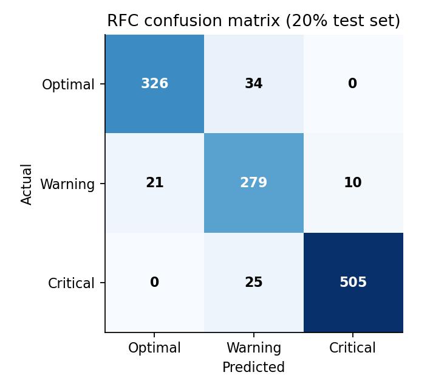
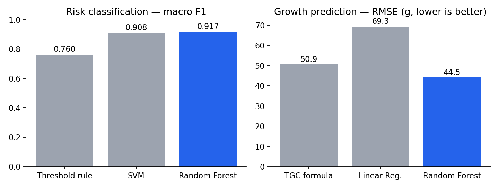
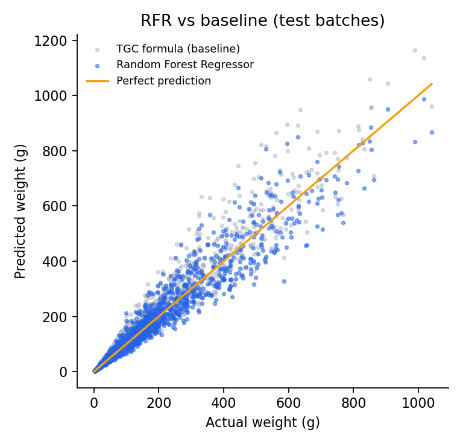
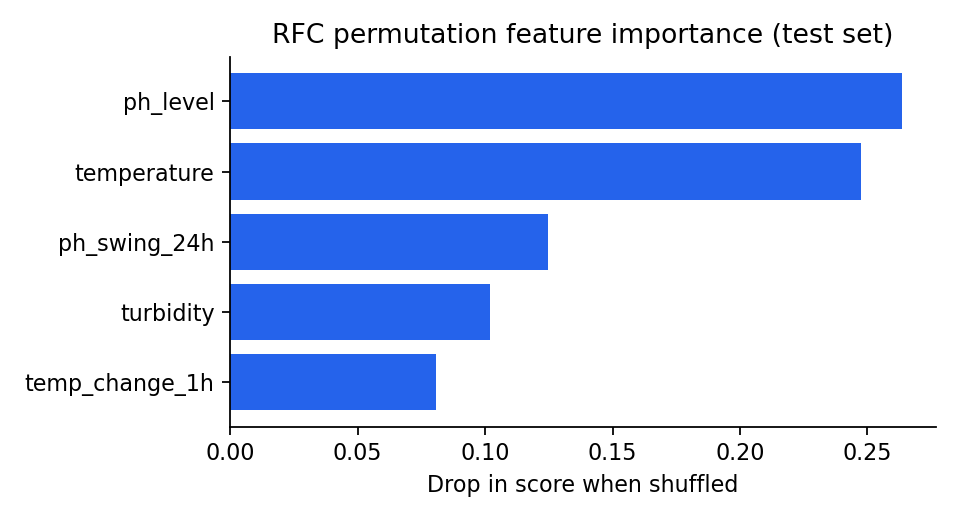
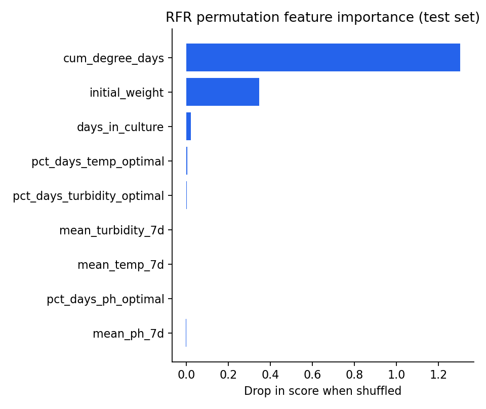

# Random Forest Model Report

Generated 2026-10-26T13:24:33 · scikit-learn 1.7.2

## Training data (historical sources only)
- Secondary dataset `Data_Model_IoTMLCQ_2024.xlsx`: 4383 rows, 360 unique after removing duplicated hourly copies. Used for normal operating conditions and as an external check.
- Published tilapia knowledge: water-quality bands, un-ionised ammonia equation (Emerson et al., 1975) and the TGC growth model (Iwama & Tautz, 1981), used to add Warning/Critical cases and growth curves.
- Live ESP32 readings are **not** used for training.

## Random Forest Classifier (risk level)
- Dataset: 6000 rows · classes {'Optimal': 1799, 'Warning': 1548, 'Critical': 2653}
- Split: 80/20 stratified · tuning: 5-fold GridSearchCV → `{'max_depth': 16, 'min_samples_leaf': 3, 'n_estimators': 200}`

| Model | Accuracy | Precision | Recall | F1 (macro) |
|---|---|---|---|---|
| Threshold rule (old) | 0.777 | 0.790 | 0.770 | 0.760 |
| SVM | 0.917 | 0.906 | 0.912 | 0.908 |
| **Random Forest** | 0.925 | 0.915 | 0.919 | 0.917 |

Per class (Random Forest):

| Class | Precision | Recall | F1 | Support |
|---|---|---|---|---|
| Optimal | 0.940 | 0.906 | 0.922 | 360 |
| Warning | 0.825 | 0.900 | 0.861 | 310 |
| Critical | 0.981 | 0.953 | 0.967 | 530 |

Test cases:

| Case | Expected | Predicted | Confidence | Pass |
|---|---|---|---|---|
| TC-03 acidic + very murky | Critical | Critical | 99% | ✅ |
| Ideal water | Optimal | Optimal | 98% | ✅ |
| Warm afternoon | Warning | Warning | 90% | ✅ |
| High pH + warm (toxic NH3) | Critical | Critical | 98% | ✅ |
| Thermal shock in range | Warning | Warning | 85% | ✅ |
| Cold spell | Critical | Critical | 98% | ✅ |

External check on the 360 real Excel records: {'Optimal': 360, 'Warning': 0, 'Critical': 0}

## Random Forest Regressor (fish weight)
- Dataset: 8280 weekly weighings from 500 culture batches
- Split: 80/20 by batch · tuning: 5-fold GroupKFold GridSearchCV → `{'max_depth': 12, 'min_samples_leaf': 5, 'n_estimators': 100}`

| Model | MSE | RMSE (g) | MAE (g) | R² |
|---|---|---|---|---|
| TGC formula (baseline) | 2590.4 | 50.9 | 27.3 | 0.911 |
| Linear Regression | 4810.1 | 69.3 | 51.3 | 0.836 |
| **Random Forest** | 1983.0 | 44.5 | 25.3 | 0.932 |

## Most important parameters (Objective I)

- Risk: ph_level (0.264), temperature (0.247), ph_swing_24h (0.124), turbidity (0.102), temp_change_1h (0.081)
- Growth: cum_degree_days (1.304), initial_weight (0.347), days_in_culture (0.023), pct_days_temp_optimal (0.007), pct_days_turbidity_optimal (0.003), mean_turbidity_7d (0.001), mean_temp_7d (0.000), pct_days_ph_optimal (-0.000), mean_ph_7d (-0.001)

## Figures

